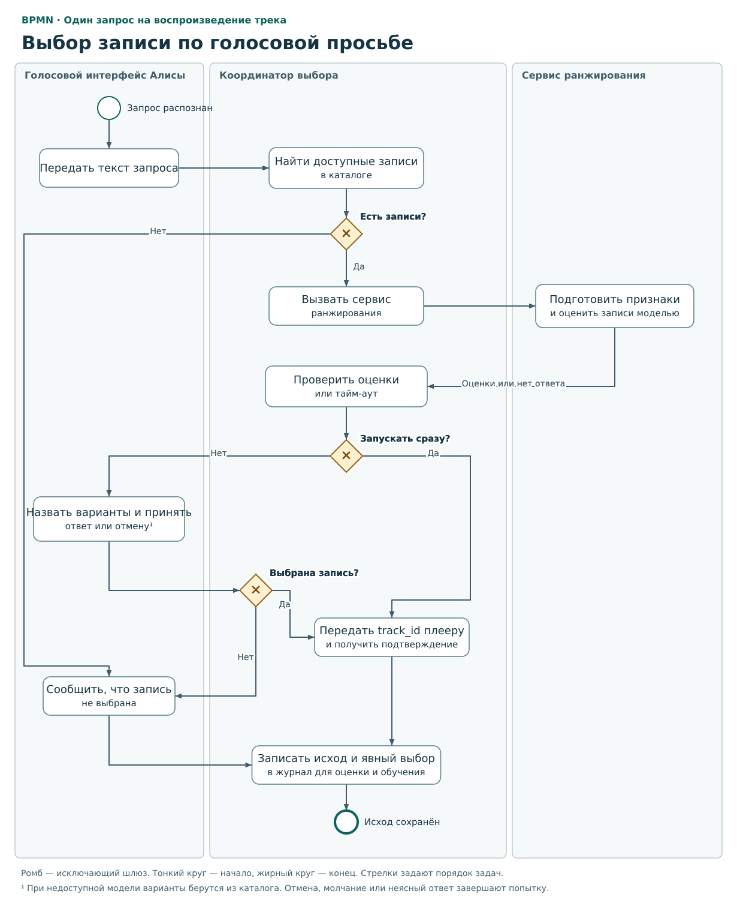
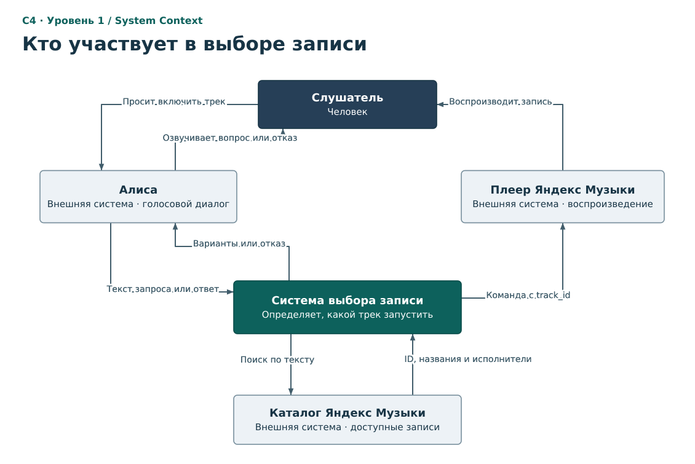
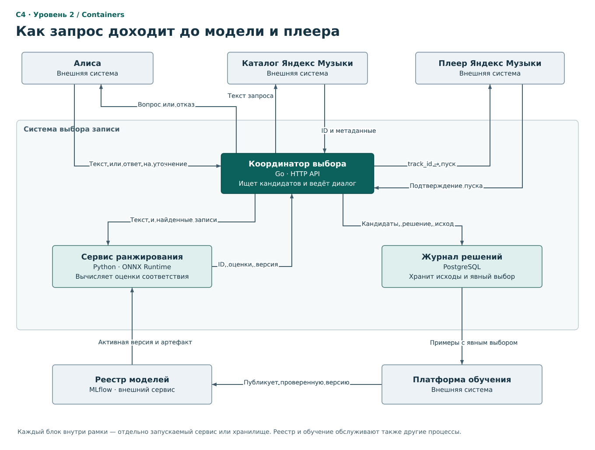
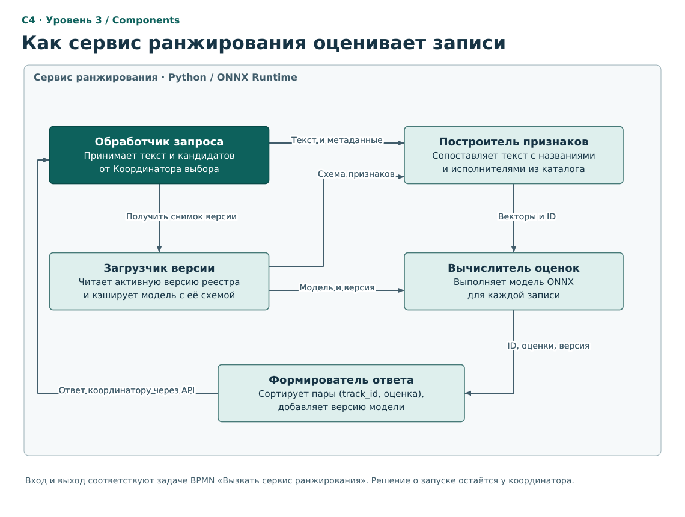

# Как Алиса выбирает, какую «Кукушку» включить

Учебная реконструкция одного процесса Яндекса. Слушатель просит Алису включить песню, а в каталоге Яндекс Музыки одному названию могут соответствовать несколько записей. Задача системы — запустить нужную версию с первой попытки. Уточнение тоже имеет цену: лишний вопрос прерывает диалог, даже если в итоге играет правильный трек.

**Границы.** На входе уже есть распознанный текст музыкальной команды. На выходе плеер подтвердил запуск выбранной записи либо Алиса сообщила, что запись выбрать не удалось. В обоих случаях система сохраняет исход. Распознавание речи, проверка подписки, передача аудиопотока и обучение модели вынесены за рамки. Каталог отдаёт записи, доступные для воспроизведения. Сбой плеера после отправки команды в этом сценарии не рассматривается.

## Что происходит на одном запросе

Допустим, после фразы «Алиса, включи “Кукушку”» в поиске остались две записи. Числа и реплики ниже иллюстрируют проектное решение.

| Текст | Оценки записей | Действие координатора |
|---|---|---|
| «Включи “Кукушку”» | «Кино» — 0,88. Полина Гагарина — 0,85 | Разрыв всего 0,03. Алиса спрашивает: «В исполнении “Кино” или Полины Гагариной?» Ответ «Гагариной» однозначно указывает, какой ID передать плееру. |
| «Включи “Кукушку” группы “Кино”» | «Кино» — 0,94. Полина Гагарина — 0,29 | Первая оценка высокая, разрыв 0,65. Координатор передаёт плееру ID записи группы «Кино». |
| Тот же запрос, но сервис ранжирования не ответил вовремя | Оценок нет | Координатор берёт варианты из результата поиска и уточняет выбор. Запуск по неполученной оценке исключён. |

**Что делает модель.** Вход — текст запроса и метаданные каждой записи: ID, название и исполнитель. Признаки описывают, например, совпадение названия и присутствие имени исполнителя в запросе. Выход — упорядоченные пары «ID записи, оценка соответствия от 0 до 1» и версия модели. Оценки рассчитываются для отдельных пар «запрос — запись» и могут одновременно быть высокими. Первым получает результат **Координатор выбора**. Именно он решает, обращаться к плееру или возвращать Алисе уточняющий вопрос.

## Схемы

| Уровень | Какой вопрос раскрывает | Исходник | Картинка |
|---|---|---|---|
| BPMN | Что происходит от распознанной просьбы до запуска или отказа? | [01-process.mmd](diagrams/01-process.mmd) | [Открыть SVG](diagrams/01-process.svg) |
| C4 · System Context | С кем взаимодействует система выбора записи? | [02-context.mmd](diagrams/02-context.mmd) | [Открыть SVG](diagrams/02-context.svg) |
| C4 · Containers | Как связаны отдельно развёртываемые сервисы и хранилище? | [03-containers.mmd](diagrams/03-containers.mmd) | [Открыть SVG](diagrams/03-containers.svg) |
| C4 · Components | Как внутри сервиса ранжирования получается ответ конкретной версии модели? | [04-components.mmd](diagrams/04-components.mmd) | [Открыть SVG](diagrams/04-components.svg) |

### BPMN · От просьбы до исхода



Дорожки обозначают зоны ответственности в одном процессе обработки запроса. Реплика слушателя поступает на дорожку голосового интерфейса. На C4 слушатель показан отдельным участником.

### C4 · Контекст



### C4 · Контейнеры



### C4 · Компоненты сервиса ранжирования



## Правила выбора и проектные допущения

1. **Поиск и ранжирование разделены.** Каталог возвращает до пяти записей в порядке текстового совпадения. Пустой список сразу приводит к сообщению об отказе. Поиск, состав кандидатов и состав признаков — допущения.
2. **Автозапуск требует двух условий.** Лучшая оценка должна быть ≥ 0,80, а её отрыв от второй — ≥ 0,15. При единственном кандидате проверяется только первое условие. Если несколько записей делят первое место, система спрашивает слушателя. Пороги выбраны для иллюстрации, измерений на данных Яндекса здесь нет.
3. **Уточнение занимает один ход.** При низкой оценке или малом отрыве Алиса называет до двух лучших вариантов. Если кандидат один, просит его подтвердить. При тайм-ауте ранжирования в 250 мс или ошибке берутся первые варианты из каталога. Если человек отверг варианты, промолчал или назвал исполнителя, которого нельзя однозначно сопоставить с предложениями, Алиса завершает попытку. Новая просьба начинает отдельный процесс.
4. **Версия модели фиксируется на запрос.** В реконструкции платформа обучения публикует проверенный артефакт в общем реестре. Загрузчик сервиса ранжирования кэширует модель вместе со схемой признаков. Один запрос использует один снимок этой пары. Если пригодной версии нет, срабатывает та же ветка уточнения.
5. **Исход связывается с решением.** Журнал содержит ID запроса, ID кандидатов, оценки и версию при их наличии, причину ветвления, предложенные ID, явный выбор и итог запуска или отказа. Состав журнала, границы сервисов и технологии на C4 — решения этой реконструкции.

## Как проверить качество

Если слушатель ответил «Гагариной», среди **предложенных** вариантов появился положительный пример. Для запросов с уточнением и доступным ответом модели можно посчитать долю случаев, когда первый кандидат модели совпал с явным выбором. Эта метрика описывает неоднозначные запросы. В выборку для оценки автозапуска отдельно включаются команды с высокой оценкой и большим отрывом: для них можно вручную разметить, указывает ли текст на одну запись. При недостатке информации допустима метка «нужно уточнение».

Подтверждение от плеера означает, что воспроизведение началось. Оно само по себе ничего не говорит о намерении слушателя. Поэтому в журнале разделены технический успех и явный выбор. Для бизнеса полезно смотреть одновременно на долю правильных автозапусков на размеченной выборке, долю уточнений и долю попыток без запуска. Платформа обучения читает из журнала примеры с явным выбором для следующей версии.

## Как BPMN соотносится с C4

| Задача на BPMN | Кто выполняет её на C4 |
|---|---|
| Передать текст запроса | Алиса → Координатор выбора |
| Найти доступные записи в каталоге | Координатор выбора ↔ Каталог Яндекс Музыки |
| Вызвать сервис ранжирования | Координатор выбора → Сервис ранжирования |
| Подготовить признаки и оценить записи моделью | Сервис ранжирования. Его внутреннее устройство раскрыто на уровне Components. |
| Проверить оценки или тайм-аут | Координатор выбора получает ответ или фиксирует истечение срока ожидания |
| Назвать варианты и принять ответ или отмену | Координатор выбора формирует варианты, Алиса ведёт диалог и возвращает результат |
| Передать track_id плееру и получить подтверждение | Координатор выбора ↔ Плеер Яндекс Музыки |
| Сообщить, что запись не выбрана | Координатор выбора → Алиса → слушатель |
| Записать исход и явный выбор в журнал для оценки и обучения | Координатор выбора → Журнал решений. Отдельным шагом вне онлайн-процесса платформа обучения читает накопленные примеры. |

## Источники и вклад реконструкции

Пользовательская возможность подтверждается справкой Яндекса: на Станции можно голосом попросить Алису включить музыку из библиотеки Яндекс Музыки. Справочник выделяет запрос на конкретный трек. [Музыка на Станции](https://alice.yandex.ru/support/ru/station/audio) · [Справочник голосовых команд](https://alice.yandex.ru/support/ru/station/skills/)

Для оформления использованы определения уровней C4 и обозначения событий, задач, дорожек и шлюзов BPMN. [Модель C4](https://c4model.com/) · [Примеры BPMN от Camunda](https://camunda.com/bpmn/examples/)

**Что придумано для этой работы.** Состав сервисов, механизм ранжирования, пороги, сценарий уточнения, реплики в примере, тайм-аут и обратная связь спроектированы для объяснения одного запроса. Публичные источники описывают пользовательскую возможность. Внутренняя архитектура Яндекса по ним не устанавливается.

## Как открыть и пересобрать

SVG открывается в GitHub или браузере и масштабируется без потери чёткости. Исходники `.mmd` можно открыть в текстовом редакторе и вставить в [Mermaid Live Editor](https://mermaid.live/). Редактор сам расставляет блоки. Для точного воспроизведения картинок из репозитория выполните из корня проекта:

```sh
python3 tools/render.py
```

Достаточно Python 3. Скрипт читает узлы, связи и комментарии Mermaid с координатами, затем пересобирает все четыре SVG в каталоге `diagrams/`.
